# Aplikacje WWW. Wykład #2 (Wersja 2026Z)
## Fundamenty Komunikacji Webowej: Protokół HTTP, HTTPS i cykl życia żądania


## Spis treści
- [Aplikacje WWW. Wykład #2 (Wersja 2026Z)](#aplikacje-www-wykład-2-wersja-2026z)
  - [Fundamenty Komunikacji Webowej: Protokół HTTP, HTTPS i cykl życia żądania](#fundamenty-komunikacji-webowej-protokół-http-https-i-cykl-życia-żądania)
  - [Spis treści](#spis-treści)
  - [1. Wprowadzenie do protokołu HTTP](#1-wprowadzenie-do-protokołu-http)
    - [1.1. Model Klient-Serwer i miejsce w stosie sieciowym (OSI vs TCP/IP)](#11-model-klient-serwer-i-miejsce-w-stosie-sieciowym-osi-vs-tcpip)
    - [1.2. Mity wokół bezstanowości (Statelessness) – protokół a stan aplikacji](#12-mity-wokół-bezstanowości-statelessness--protokół-a-stan-aplikacji)
  - [2. Identyfikacja zasobów: URI, URL oraz URN](#2-identyfikacja-zasobów-uri-url-oraz-urn)
    - [2.1. Anatomia identyfikatora URI (RFC 3986)](#21-anatomia-identyfikatora-uri-rfc-3986)
      - [Szczegółowy opis komponentów:](#szczegółowy-opis-komponentów)
    - [2.2. Enkodowanie URL (Percent-Encoding)](#22-enkodowanie-url-percent-encoding)
  - [3. Ewolucja architektury protokołu: od HTTP/0.9 do HTTP/3](#3-ewolucja-architektury-protokołu-od-http09-do-http3)
    - [3.1. Przegląd generacji (0.9, 1.0, 1.1, 2, 3)](#31-przegląd-generacji-09-10-11-2-3)
      - [HTTP/0.9 (1991) – "Protokół jedno-linijkowy"](#http09-1991--protokół-jedno-linijkowy)
      - [HTTP/1.0 (1996, RFC 1945)](#http10-1996-rfc-1945)
    - [3.2. HTTP/1.1: Trwałe połączenia (Keep-Alive) i ograniczenia pipeliningu](#32-http11-trwałe-połączenia-keep-alive-i-ograniczenia-pipeliningu)
      - [Problem Head-of-Line (HoL) Blocking w HTTP/1.1:](#problem-head-of-line-hol-blocking-w-http11)
    - [3.3. HTTP/2: Ramkowanie binarne, multipleksacja i zmierzch Server Push](#33-http2-ramkowanie-binarne-multipleksacja-i-zmierzch-server-push)
      - [Dlaczego Server Push w HTTP/2 okazał się niewypałem?](#dlaczego-server-push-w-http2-okazał-się-niewypałem)
    - [3.4. HTTP/3 i protokół QUIC: Rozwiązanie problemu Head-of-Line Blocking na poziomie transportu](#34-http3-i-protokół-quic-rozwiązanie-problemu-head-of-line-blocking-na-poziomie-transportu)
      - [Najważniejsze innowacje HTTP/3 i QUIC:](#najważniejsze-innowacje-http3-i-quic)
    - [3.5. Zestawienie i aktualne specyfikacje RFC (Stan na 2026 rok)](#35-zestawienie-i-aktualne-specyfikacje-rfc-stan-na-2026-rok)
  - [4. Semantyka żądań: Metody HTTP](#4-semantyka-żądań-metody-http)
    - [4.1. Przegląd metod standardowych](#41-przegląd-metod-standardowych)
    - [4.2. Bezpieczeństwo (Safe) i Idempotentność (Idempotent) metod](#42-bezpieczeństwo-safe-i-idempotentność-idempotent-metod)
      - [Definicje inżynierskie:](#definicje-inżynierskie)
      - [Tabela właściwości:](#tabela-właściwości)
    - [4.3. PUT vs PATCH – semantyka aktualizacji zasobu](#43-put-vs-patch--semantyka-aktualizacji-zasobu)
  - [5. Semantyka odpowiedzi: Kody statusu HTTP](#5-semantyka-odpowiedzi-kody-statusu-http)
    - [5.1. Klasyfikacja kodów (1xx – 5xx)](#51-klasyfikacja-kodów-1xx--5xx)
    - [5.2. Najważniejsze kody statusu w inżynierii webowej i projektowaniu API](#52-najważniejsze-kody-statusu-w-inżynierii-webowej-i-projektowaniu-api)
      - [Kody 2xx (Sukces):](#kody-2xx-sukces)
      - [Kody 3xx (Przekierowania):](#kody-3xx-przekierowania)
      - [Kody 4xx (Błędy Klienta):](#kody-4xx-błędy-klienta)
      - [Kody 5xx (Błędy Serwera):](#kody-5xx-błędy-serwera)
    - [5.3. 401 Unauthorized vs 403 Forbidden – kluczowe rozróżnienie](#53-401-unauthorized-vs-403-forbidden--kluczowe-rozróżnienie)
    - [5.4. Przekierowania: 301 vs 302 vs 307 vs 308](#54-przekierowania-301-vs-302-vs-307-vs-308)
  - [6. Anatomia wiadomości HTTP i kluczowe nagłówki](#6-anatomia-wiadomości-http-i-kluczowe-nagłówki)
    - [6.1. Struktura komunikatu (Request \& Response)](#61-struktura-komunikatu-request--response)
    - [6.2. Negocjacja treści (Content Negotiation)](#62-negocjacja-treści-content-negotiation)
    - [6.3. Mechanizmy pamięci podręcznej (Caching \& Conditional Requests)](#63-mechanizmy-pamięci-podręcznej-caching--conditional-requests)
      - [Kluczowe nagłówki:](#kluczowe-nagłówki)
    - [6.4. Zarządzanie tożsamością i sesją: Ciasteczka i tokeny](#64-zarządzanie-tożsamością-i-sesją-ciasteczka-i-tokeny)
      - [Bezpieczeństwo ciasteczek – parametry obowiązkowe w produkcji:](#bezpieczeństwo-ciasteczek--parametry-obowiązkowe-w-produkcji)
    - [6.5. Bezpieczeństwo i polityki przeglądarkowe (HSTS, CSP, CORS)](#65-bezpieczeństwo-i-polityki-przeglądarkowe-hsts-csp-cors)
  - [7. Protokół HTTPS i warstwa TLS](#7-protokół-https-i-warstwa-tls)
    - [7.1. Dlaczego sam HTTP jest niebezpieczny? Podsłuch, modyfikacja, podszywanie](#71-dlaczego-sam-http-jest-niebezpieczny-podsłuch-modyfikacja-podszywanie)
    - [7.2. Model kryptografii hybrydowej](#72-model-kryptografii-hybrydowej)
    - [7.3. Przebieg uścisku dłoni (TLS 1.3 Handshake)](#73-przebieg-uścisku-dłoni-tls-13-handshake)
    - [7.4. Certyfikaty cyfrowe X.509, PKI, Let's Encrypt i rola SNI / ALPN](#74-certyfikaty-cyfrowe-x509-pki-lets-encrypt-i-rola-sni--alpn)
      - [Rola mechanizmów SNI oraz ALPN:](#rola-mechanizmów-sni-oraz-alpn)
  - [8. Od gniazda TCP do frameworka webowego: Cykl życia żądania w Django](#8-od-gniazda-tcp-do-frameworka-webowego-cykl-życia-żądania-w-django)
    - [8.1. Architektura serwera: Reverse Proxy (Nginx) -\> WSGI/ASGI (Gunicorn/Uvicorn)](#81-architektura-serwera-reverse-proxy-nginx---wsgiasgi-gunicornuvicorn)
    - [8.2. Transformacja: od surowego strumienia bajtów do obiektu `HttpRequest`](#82-transformacja-od-surowego-strumienia-bajtów-do-obiektu-httprequest)
    - [8.3. Łańcuch przetwarzania (Middleware Pipeline) i zwrot `HttpResponse`](#83-łańcuch-przetwarzania-middleware-pipeline-i-zwrot-httpresponse)
  - [9. Warsztat inżynierski: Diagnostyka i inspekcja HTTP](#9-warsztat-inżynierski-diagnostyka-i-inspekcja-http)
    - [9.1. Zaawansowane wykorzystanie cURL](#91-zaawansowane-wykorzystanie-curl)
    - [9.2. Wykorzystanie Chrome DevTools (zakładka Network)](#92-wykorzystanie-chrome-devtools-zakładka-network)
  - [10. Materiały, literatura i ciekawostki](#10-materiały-literatura-i-ciekawostki)
    - [Literatura i specyfikacje standardów:](#literatura-i-specyfikacje-standardów)
    - [Ciekawostki inżynierskie:](#ciekawostki-inżynierskie)

---

## 1. Wprowadzenie do protokołu HTTP

Protokół **HTTP (Hypertext Transfer Protocol)** to fundament wymiany danych w sieci World Wide Web. Został zapoczątkowany przez **Tima Bernersa-Lee** w 1989 roku w ośrodku CERN jako prosty mechanizm przesyłania dokumentów hipertekstowych. Współcześnie HTTP stanowi uniwersalny protokół warstwy aplikacji, na którym opierają się nie tylko klasyczne witryny internetowe, ale przede wszystkim rozproszone architektury backendowe, interfejsy REST API, GraphQL, mikroserwisy oraz aplikacje mobilne.

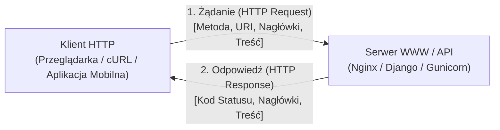

### 1.1. Model Klient-Serwer i miejsce w stosie sieciowym (OSI vs TCP/IP)

Komunikacja HTTP opiera się na klasycznym modelu **klient-serwer**:
* **Klient (User Agent)** inicjuje połączenie, wysyłając sformatowane **żądanie (*request*)**.
* **Serwer** przetwarza żądanie i odsyła **odpowiedź (*response*)**.
* Domyślny port nieszyfrowanego protokołu HTTP to **port 80**, natomiast szyfrowanego HTTPS – **port 443**.

W hierarchii modeli sieciowych HTTP znajduje się na najwyższym poziomie:

| Warstwa modelu ISO/OSI | Warstwa modelu TCP/IP | Protokoły / Jednostki danych | Rola w komunikacji webowej |
| :--- | :--- | :--- | :--- |
| **7. Aplikacji** | **Aplikacji** | **HTTP / HTTPS**, DNS, WebSocket | Definiuje format i semantykę komunikatów (*Request/Response*). |
| **6. Prezentacji** | Aplikacji | TLS / SSL, JSON, HTML, gzip | Odpowiada za szyfrowanie, kompresję i kodowanie danych. |
| **5. Sesji** | Aplikacji | Zarządzanie sesją gniazd sieciowych | Utrzymanie logicznego połączenia aplikacji. |
| **4. Transportowa** | **Transportowa** | **TCP** (HTTP/1.1, HTTP/2) / **UDP** (HTTP/3 - QUIC) | Niezawodne (TCP) lub szybkie strumieniowe (UDP) przesyłanie pakietów między portami. |
| **3. Sieciowa** | **Internetowa** | **IPv4 / IPv6**, ICMP, routing | Adresowanie hostów i wyznaczanie trasy pakietów w sieci globalnej. |
| **2. Łącza danych** | **Dostępu do sieci** | Ethernet, Wi-Fi, ramki MAC | Fizyczna transmisja ramek pomiędzy bezpośrednimi węzłami sieci. |
| **1. Fizyczna** | Dostępu do sieci | Światłowód, fale radiowe, miedź | Transmisja bitów w medium fizycznym. |

> [!NOTE] Warte odnotowania
> Do wersji HTTP/2 protokół HTTP bezwzględnie wymagał niezawodnego protokołu transportowego **TCP** z mechanizmem kontroli przepływu i retransmisji utraconych pakietów. Przełomowa zmiana w **HTTP/3** przeniosła warstwę transportową na protokół **UDP**, realizując niezawodność i szyfrowanie w nowej warstwie **QUIC**.

---

### 1.2. Mity wokół bezstanowości (Statelessness) – protokół a stan aplikacji

Jedną z fundamentalnych reguł architektury HTTP jest jego **bezstanowość (*stateless nature*)**:
* Protokół HTTP nie wymaga od serwera zachowywania jakichkolwiek informacji o poprzednich żądaniach klienta pomiędzy kolejnymi transakcjami. Każde żądanie jest traktowane w sposób w pełni autonomiczny i izolowany.
* Jeśli klient wysyła żądanie `A`, a sekundę później żądanie `B`, to z punktu widzenia specyfikacji HTTP serwer obsługujący `B` nie musi wiedzieć, że żądanie `A` w ogóle miało miejsce.

> [!WARNING] Uwaga
> **Powszechny błąd pojęciowy:** W wielu publikacjach można spotkać mylne twierdzenie, że *„poprzez wprowadzenie ciasteczek protokół HTTP przestał być bezstanowy”*.  
> **Sprostowanie:** Protokół HTTP **pozostaje protokołem bezstanowym** na poziomie swojej definicji (RFC 9110). Stanowość jest emulowana w **warstwie aplikacji** za pośrednictwem nagłówków HTTP (`Cookie`, `Set-Cookie`, `Authorization: Bearer <token>`). Każde żądanie musi jawnie zawierać te nagłówki, aby serwer mógł powiązać je z daną sesją w swojej pamięci lub bazie danych.

Bezstanowość protokołu jest kluczem do budowy skalowalnych systemów webowych:
1. Umożliwia prosty **Load Balancing**: dowolny serwer za balancerem może obsłużyć dowolne żądanie bez konieczności kosztownej synchronizacji pamięci operacyjnej między instancjami.
2. Zmniejsza zapotrzebowanie na zasoby serwera: w przypadku zerwania połączenia serwer nie musi sprzątać wiszących stanów protokołu.
3. Stanowi fundament stylu architektonicznego **REST** (*Stateless Constraint*).

---

## 2. Identyfikacja zasobów: URI, URL oraz URN

W protokole HTTP każde żądanie operuje na konkretnym **zasobie** (*resource*). Zasobem może być dokument HTML, plik graficzny PNG, wpis w bazie danych reprezentowany jako JSON, a nawet dynamiczny proces obliczeniowy.

Do jednoznacznej identyfikacji zasobów służy rodzina standardów oparta o **URI**:

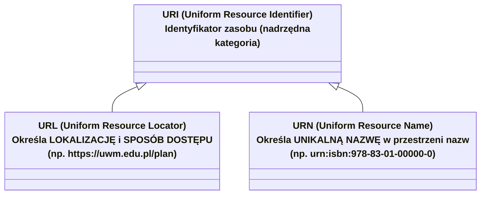

* **URI (Uniform Resource Identifier)**: Ogólny termin określający ciąg znaków jednoznacznie identyfikujący dany zasób.
* **URL (Uniform Resource Locator)**: Najczęstsza postać URI w sieci WWW. Określa nie tylko tożsamość zasobu, ale przede wszystkim **lokalizację sieciową i protokół dostępu**.
* **URN (Uniform Resource Name)**: Identyfikuje zasób po nazwie, niezależnie od miejsca jego przechowywania i dostępności w sieci (np. `urn:ietf:rfc:9110`).

### 2.1. Anatomia identyfikatora URI (RFC 3986)

Specyfikacja **RFC 3986** definiuje pełną składnię adresu URI w następującej postaci:

```text
  foo://example.com:8042/over/there?name=ferret#nose
  \_/   \______________/\_________/ \_________/ \__/
   |           |             |           |        |
scheme     authority       path        query   fragment
```

Rozwinięcie komponentu `authority`:
```text
  [userinfo@]host[:port]
```

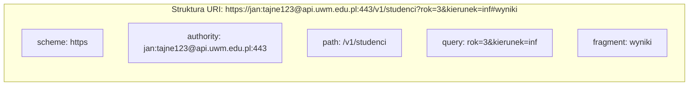

#### Szczegółowy opis komponentów:
1. **Scheme (Schemat / Protokół)**:
   * Określa protokół lub mechanizm dostępu do zasobu (np. `http`, `https`, `ftp`, `mailto`, `data`). Wymuszany wielkością liter jako lowercase (np. `https`).
2. **Authority (Autorytet / Adres hosta)**:
   * **Userinfo** (`username:password@`): *Przestarzałe i niebezpieczne!* Przesyłanie haseł w adresie URL powoduje ich zapis w logach proxy, przeglądarek i serwerów.
   * **Host**: Domena internetowa (np. `uwm.edu.pl`), adres IPv4 (np. `192.168.1.1`) lub adres IPv6 ujęty w nawiasy kwadratowe (np. `[2001:db8::1]`).
   * **Port**: Numer portu docelowego. Opcjonalny, jeżeli używany jest port domyślny dla danego schematu (80 dla HTTP, 443 dla HTTPS).
3. **Path (Ścieżka)**:
   * Hierarchiczna ścieżka do zasobu, z segmentami oddzielanymi znakiem ukośnika `/`. W nowoczesnych API REST reprezentuje hierarchię zasobów (np. `/api/v1/kursy/12/oceny`).
4. **Query (Zapytanie / Parametry GET)**:
   * Opcjonalny ciąg parametrów rozpoczynający się od znaku zapytania `?`.
   * Standardowo zapisywany w formacie par klucz-wartość rozdzielanych znakiem ampersand: `klucz1=wartosc1&klucz2=wartosc2`.
   * Służy do filtrowania, sortowania lub stronicowania zasobów.
5. **Fragment (Kotwica)**:
   * Opcjonalny identyfikator rozpoczynający się od znaku `#`.
   * **Nigdy nie jest wysyłany do serwera w żądaniu HTTP!** Jest interpretowany wyłącznie lokalnie przez klienta (przeglądarkę), np. do przewinięcia strony do nagłówka o danym ID lub nawigacji w aplikacjach SPA (*Client-side Routing*).

---

### 2.2. Enkodowanie URL (Percent-Encoding)

Adresy URI dopuszczają wyłącznie określony podzbiór znaków ze standardu US-ASCII. Wszystkie pozostałe znaki (w tym polskie znaki diakrytyczne, spacje oraz znaki zarezerwowane używane poza swoją rolą syntaktyczną) muszą zostać zakodowane w formacie **Percent-Encoding** (`%XX`, gdzie `XX` to szesnastkowa wartość bajtu w UTF-8):

| Znak oryginalny | Reprezentacja w URI | Zastosowanie / Uwaga |
| :---: | :---: | :--- |
| ` ` (spacja) | `%20` (lub `+` w query) | Odstęp w ścieżce lub parametrze |
| `/` | `%2F` | Gdy ukośnik jest częścią wartości, a nie separatorem ścieżki |
| `?` | `%3F` | Gdy znak zapytania jest częścią wartości parametru |
| `&` | `%26` | Gdy ampersand jest częścią wartości parametru |
| `ą` | `%C4%85` | Dwa bajty UTF-8: `0xC4`, `0x85` |
| `ł` | `%C5%82` | Dwa bajty UTF-8: `0xC5`, `0x82` |

---

## 3. Ewolucja architektury protokołu: od HTTP/0.9 do HTTP/3

Ewolucja protokołu HTTP to historia walki o redukcję **opóźnień sieciowych (latency)**, optymalizację wykorzystania pasma oraz eliminację zjawiska blokowania kolejki żądań.

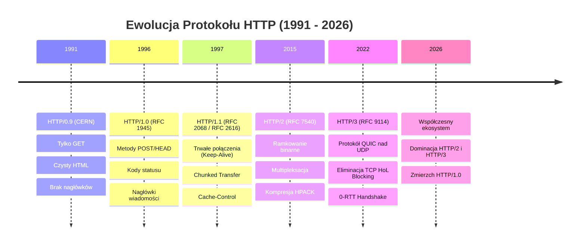

### 3.1. Przegląd generacji (0.9, 1.0, 1.1, 2, 3)

#### HTTP/0.9 (1991) – "Protokół jedno-linijkowy"
* Jedyna dostępna metoda: `GET /sciezka`.
* Brak nagłówków, brak kodów statusu, brak obsługi typów MIME.
* Odpowiedź stanowił wyłącznie surowy strumień kodu HTML.
* Po przesłaniu pliku serwer natychmiast zamykał fizyczne połączenie TCP.

#### HTTP/1.0 (1996, RFC 1945)
* Wprowadzenie nagłówków żądania i odpowiedzi (`Content-Type`, `User-Agent`).
* Dodanie kodów statusu odpowiedzi (200 OK, 404 Not Found itp.).
* Wprowadzenie metod `POST` oraz `HEAD`, umożliwiając wysyłanie formularzy i multimediów.
* **Wada kardynalna:** Każdy zasób (strona HTML, każdy obrazek, każdy arkusz stylów) wymagał otwarcia **nowego połączenia TCP** (koszt 3-way handshake SYN-SYN/ACK-ACK przy każdym pliku!).

---

### 3.2. HTTP/1.1: Trwałe połączenia (Keep-Alive) i ograniczenia pipeliningu

Wydana w 1997/1999 roku specyfikacja HTTP/1.1 zrewolucjonizowała sieć WWW, wprowadzając mechanizmy obowiązujące do dziś:
1. **Domyślnie trwałe połączenia (*Persistent Connections / Keep-Alive*)**:
   * Połączenie TCP nie jest zamykane po obsłużeniu jednego żądania. To samo gniazdo sieciowe może obsłużyć kolejne zapytania o pliki CSS, JS i grafiki, eliminując koszt powtarzanego uścisku dłoni TCP.
2. **Chunked Transfer Encoding**:
   * Możliwość strumieniowania odpowiedzi serwera w częściach bez wcześniejszej znajomości całkowitego rozmiaru zasobu (`Content-Length`).
3. **Nagłówek `Host` jako obowiązkowy**:
   * Umożliwiło to wirtualny hosting (utrzymywanie wielu różnych domen i serwisów na jednym fizycznym adresie IP serwera).
4. **Zaawansowane mechanizmy pamięci podręcznej**:
   * Wprowadzenie nagłówków `Cache-Control`, `ETag` oraz zapytań warunkowych (`If-None-Match`).

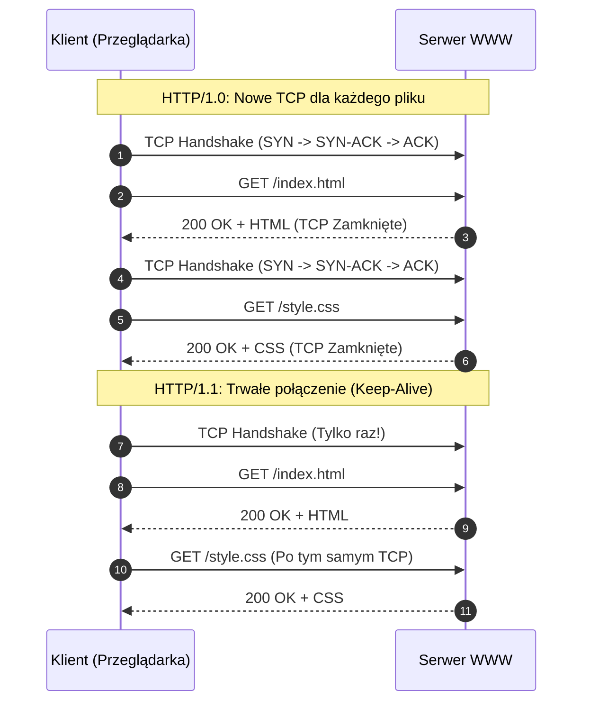

#### Problem Head-of-Line (HoL) Blocking w HTTP/1.1:
W HTTP/1.1 żądania w ramach jednego połączenia TCP musiały być przetwarzane ściśle **sekwencyjnie**: odpowiedź na żądanie drugie nie mogła zostać wysłana, dopóki serwer nie skończył generować i wysyłać odpowiedzi na żądanie pierwsze. Jeśli pierwsze zapytanie było ciężkim procesem SQL, blokowało całe łącze dla pozostałych zasobów.

Przeglądarki radziły sobie z tym, otwierając do **6 równoległych połączeń TCP** do tej samej domeny, co jednak drastycznie obciążało serwery i łącza sieciowe. Technika *HTTP Pipelining* (wysyłanie zapytań bez czekania na odpowiedź) okazała się zawodna w praktyce ze względu na błędy w routerach pośredniczących (*middleboxes*) i została wyłączona w większości przeglądarek.

---

### 3.3. HTTP/2: Ramkowanie binarne, multipleksacja i zmierzch Server Push

Opublikowany w 2015 roku standard **HTTP/2 (RFC 7540, aktualizacja RFC 9113)** przeniósł architekturę HTTP na zupełnie nowy poziom:

1. **Warstwa ramkowania binarnego (*Binary Framing Layer*)**:
   * Zastąpiono tradycyjne komunikaty tekstowe binarnymi ramkami (np. ramki `HEADERS`, `DATA`, `SETTINGS`, `RST_STREAM`).
2. **Multipleksacja strumieni (*Multiplexing*)**:
   * W ramach **jednego fizycznego połączenia TCP** klient i serwer mogą przeplatać ramki pochodzące z dziesiątek niezależnych, dwukierunkowych strumieni (*streams*).
   * Żadne powolne żądanie nie blokuje już pozostałych w warstwie aplikacji!


3. **Kompresja nagłówków HPACK**:
   * W HTTP/1.1 powtarzające się nagłówki (ciasteczka o wadze kilkunastu kilobajtów, User-Agent) były przesyłane w całości przy każdym zapytaniu. HPACK eliminuje tę redundancję za pomocą wspólnej tablicy indeksów.
4. **Priorytetyzacja strumieni**:
   * Przeglądarka może wskazać, że krytyczny plik CSS ma wyższy priorytet niż tło graficzne strony.

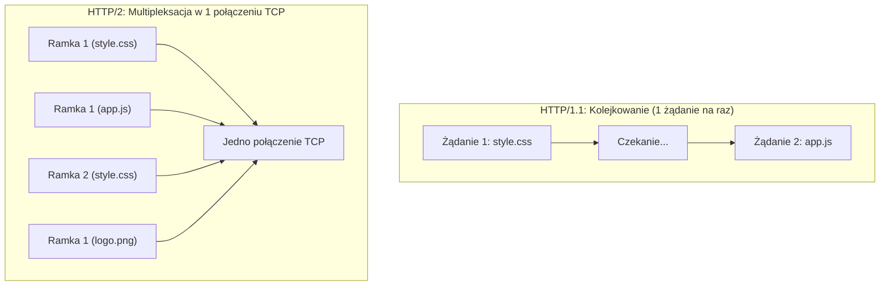

#### Dlaczego Server Push w HTTP/2 okazał się niewypałem?
Początkowo entuzjastycznie przyjęty mechanizm *Server Push* (wysyłanie przez serwer plików CSS/JS zanim przeglądarka o nie poprosi) przysparzał w produkcji ogromnych problemów:
* Serwery często przepychały zasoby, które przeglądarka **miała już w lokalnej pamięci podręcznej (cache)**, marnując cenne pasmo na łączach mobilnych.
* Wdrażanie logiki push po stronie backendu było skomplikowane i podatne na wyścigi (*race conditions*).
* W efekcie Google Chrome wyłączyło obsługę Server Push, a w HTTP/3 mechanizm ten został zmarginalizowany. Jego nowoczesnym, zoptymalizowanym następcą stał się kod **103 Early Hints** (RFC 8297).

---

### 3.4. HTTP/3 i protokół QUIC: Rozwiązanie problemu Head-of-Line Blocking na poziomie transportu

Choć HTTP/2 rozwiązał problem HoL na poziomie aplikacji, natrafił na barierę nie do pokonania w samej architekturze protokołu **TCP**:
* W protokole TCP wszystkie dane traktowane są jako jeden ciągły strumień bajtów.
* Jeśli w trakcie transmisji zmultipleksowanego połączenia HTTP/2 **zgubi się choćby jeden pakiet IP**, stos TCP wstrzymuje dostarczenie wszystkich danych do aplikacji do momentu retransmisji utraconego pakietu. W ten sposób strata pakietu z mało ważnego obrazka blokuje wykonanie skryptu JavaScript!

Rozwiązaniem stał się opublikowany w 2022 roku **HTTP/3 (RFC 9114)**:

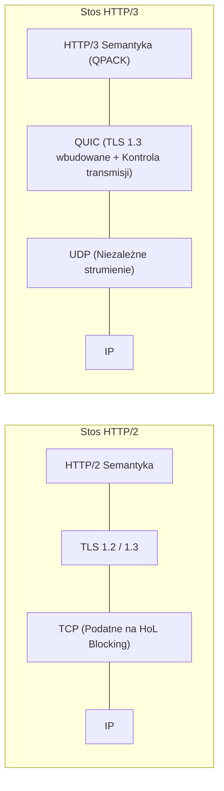

#### Najważniejsze innowacje HTTP/3 i QUIC:
1. **Oparcie o UDP i warstwę QUIC**:
   * Poszczególne strumienie wewnątrz QUIC są od siebie całkowicie odizolowane na poziomie transportowym. Utrata pakietu w strumieniu `A` nie opóźnia odczytu pakietów ze strumienia `B`.
2. **0-RTT Connection Establishment**:
   * Ponowne łączenie z serwerem, z którym klient już wcześniej rozmawiał, nie wymaga żadnych wstępnych rund sieciowych – dane żądania HTTP mogą lecieć w pierwszym pakiecie wraz z parametrami kryptograficznymi.
3. **Connection Migration (Odporność na zmianę IP)**:
   * Tradycyjne połączenie TCP definiowane jest przez tzw. 4-krotkę: `(IP źródłowe, Port źródłowy, IP docelowe, Port docelowy)`. Gdy użytkownik smartfona wyjdzie z domu i przełączy się z Wi-Fi na LTE, jego IP ulega zmianie, a wszystkie połączenia TCP zostają zerwane.
   * QUIC identyfikuje połączenie za pomocą unikalnego **Connection ID (CID)**. Zmiana adresu IP klienta nie przerywa trwającej transmisji!
4. **Obligatoryjne szyfrowanie**:
   * W QUIC warstwa uścisku TLS 1.3 jest nierozerwalnie zintegrowana z protokołem. Pakiety i nagłówki transportowe są zaszyfrowane, uniemożliwiając podsłuch i manipulację przez urządzenia tranzytowe.
5. **Algorytm kompresji QPACK**:
   * Zastąpił HPACK, gwarantując bezpieczną dekompresję nagłówków nawet przy dostarczaniu pakietów UDP w zmienionej kolejności (*out-of-order delivery*).

---

### 3.5. Zestawienie i aktualne specyfikacje RFC (Stan na 2026 rok)

W czerwcu 2022 roku grupa robocza IETF dokonała gruntownej reorganizacji dokumentów RFC. Przestarzałe specyfikacje (RFC 2616, RFC 7230–7235) zostały formalnie zastąpione nową rodziną standardów:

| Protokół | Rok | Aktualne RFC | Protokół transportowy | Bezpieczeństwo | Główne cechy |
| :--- | :---: | :---: | :---: | :---: | :--- |
| **HTTP/1.1** | 1997 / 2022 | **RFC 9112** (semantyka: **RFC 9110**) | TCP | Opcjonalny TLS (port 80/443) | Format tekstowy, Keep-Alive, chunked transfer, HoL blocking na poziomie aplikacji. |
| **HTTP/2** | 2015 / 2022 | **RFC 9113** (semantyka: **RFC 9110**) | TCP | De facto wymagany TLS | Format binarny, multipleksacja strumieni, kompresja HPACK, podatny na TCP HoL. |
| **HTTP/3** | 2022 | **RFC 9114** (QUIC: **RFC 9000**) | UDP (QUIC) | Wbudowany TLS 1.3 (obligatoryjny) | Brak TCP HoL blocking, migracja połączeń, 0-RTT, kompresja QPACK. |

---

## 4. Semantyka żądań: Metody HTTP

Metoda HTTP określa pożądaną operację, jaką klient zamierza wykonać na wskazanym zasobie. Semantyka metod została ujednolicona w dokumencie **RFC 9110**.

### 4.1. Przegląd metod standardowych

| Metoda | Domyślne przeznaczenie | Posiada Body w Request? | Posiada Body w Response? |
| :--- | :--- | :---: | :---: |
| **GET** | Pobranie reprezentacji zasobu | NIE (ignorowane) | **TAK** |
| **POST** | Utworzenie podrzędnego zasobu lub przetworzenie danych formularza | **TAK** | **TAK** |
| **PUT** | Całkowite zastąpienie zasobu lub jego utworzenie pod zadanym URI | **TAK** | Opcjonalnie |
| **PATCH** | Częściowa modyfikacja istniejącego zasobu | **TAK** | **TAK** |
| **DELETE**| Usunięcie wskazanego zasobu z serwera | Zazwyczaj NIE | Opcjonalnie |
| **HEAD** | Identyczna z GET, lecz serwer zwraca **wyłącznie nagłówki** | NIE | **NIE** |
| **OPTIONS**| Zapytanie o dozwolone metody i możliwości serwera (CORS Preflight) | NIE | Opcjonalnie |
| **TRACE** | Diagnostyczne odbicie żądania (echo) w celu analizy pośredników | NIE | TAK |
| **CONNECT**| Zestawienie tunelu sieciowego TCP (np. proxy dla HTTPS) | Opcjonalnie | Opcjonalnie |

---

### 4.2. Bezpieczeństwo (Safe) i Idempotentność (Idempotent) metod

Rozróżnienie właściwości metod HTTP to jedno z najważniejszych zagadnień inżynierii oprogramowania webowego:

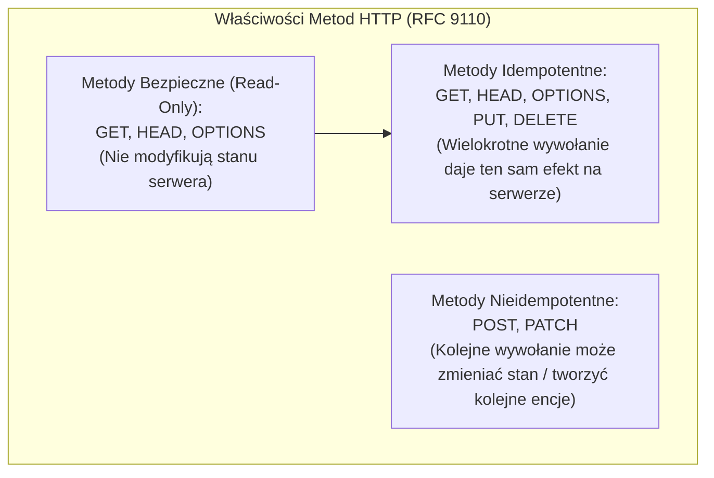

#### Definicje inżynierskie:
1. **Metoda Bezpieczna (*Safe Method*)**:
   * Wywołanie żądania nie powoduje żadnej modyfikacji stanu zasobów na serwerze (operacja typu *read-only*).
   * Może być bezpiecznie indeksowane przez roboty wyszukiwarek (np. Googlebot) i agresywnie buforowane w pamięci podręcznej (cache).
2. **Metoda Idempotentna (*Idempotent Method*)**:
   * Wykonanie identycznego żądania jednokrotnie wywołuje **taki sam skutek na stan serwera**, jak wykonanie go $N$-krotnie ($f(x) = f(f(x))$).
   * **Ważna konsekwencja dla sieci:** Jeśli żądanie `PUT` lub `DELETE` zostanie przerwane przez timeout sieciowy, klient lub biblioteka HTTP może **bezpiecznie ponowić zapytanie (*automatic retry*)** bez obawy o skutki uboczne.
3. **Metoda Nieidempotentna (*Non-idempotent*)**:
   * Ponowienie zapytania może spowodować zwielokrotnienie efektu biznesowego (np. dwukrotne obciążenie karty kredytowej przy ponowieniu żądania `POST /api/platnosci`).
   * Z tego powodu przeglądarki internetowe wyświetlają ostrzeżenie przy próbie odświeżenia strony po wysłaniu formularza metodą POST (*„Form Resubmission Warning”*), zapobiegając nieumyślnemu powtórzeniu transakcji (rozwiązywane wzorcem **Post/Redirect/Get**).

#### Tabela właściwości:

| Metoda | Bezpieczna (Safe)? | Idempotentna (Idempotent)? | Buforowalna w Cache? | Bezpieczne automatyczne ponowienie (Retry)? |
| :---: | :---: | :---: | :---: | :---: |
| **GET** | **TAK** | **TAK** | **TAK** | **TAK** |
| **HEAD** | **TAK** | **TAK** | **TAK** | **TAK** |
| **OPTIONS** | **TAK** | **TAK** | NIE | **TAK** |
| **PUT** | NIE | **TAK** | NIE | **TAK** |
| **DELETE** | NIE | **TAK** | NIE | **TAK** |
| **POST** | NIE | **NIE** | Warunkowo | **NIE** |
| **PATCH** | NIE | **NIE** | Warunkowo | **NIE** |

---

### 4.3. PUT vs PATCH – semantyka aktualizacji zasobu

Częstym błędem programistycznym w projektowaniu REST API jest zamienne stosowanie metod `PUT` i `PATCH`. Specyfikacja nakłada na nie odmienną semantykę:

* **`PUT /api/studenci/10` (Pełna wymiana zasobu)**:
  * Klient przesyła **pełną nową reprezentację zasobu**.
  * Wszystkie pola nieobecne w przesyłanym ciele żądania powinny zostać zresetowane do wartości domyślnych lub usunięte (`NULL`).
  * Jeśli encja pod podanym identyfikatorem nie istnieje, serwer może ją utworzyć pod tym adresem.
* **`PATCH /api/studenci/10` (Modyfikacja częściowa)**:
  * Klient przesyła **wyłącznie zestaw zmian (tzw. delta lub diff)**, które należy zaaplikować do istniejącego zasobu (np. zmianę samego nazwiska lub adresu e-mail). Pozostałe atrybuty pozostają nienaruszone.

---

## 5. Semantyka odpowiedzi: Kody statusu HTTP

Kod statusu (*Status Code*) to trzycyfrowa liczba całkowita zwracana w pierwszej linii odpowiedzi serwera, informująca klienta o rezultacie przetworzenia żądania.

### 5.1. Klasyfikacja kodów (1xx – 5xx)

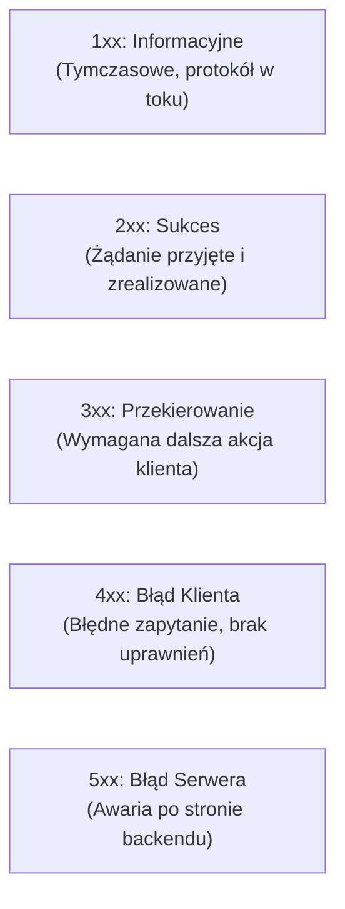

* **1xx (Informational)**: Żądanie zostało odebrane; proces jest kontynuowany.
* **2xx (Success)**: Akcja klienta została pomyślnie odebrana, zrozumiana i zaakceptowana.
* **3xx (Redirection)**: W celu ukończenia żądania klient musi podjąć dodatkowe kroki (np. odpytać inny adres URL).
* **4xx (Client Error)**: Żądanie zawiera błędy składniowe lub nie może zostać zrealizowane z winy klienta.
* **5xx (Server Error)**: Serwer uległ awarii lub nie jest w stanie obsłużyć poprawnie skonstruowanego żądania.

---

### 5.2. Najważniejsze kody statusu w inżynierii webowej i projektowaniu API

#### Kody 2xx (Sukces):
* **200 OK**: Standardowa odpowiedź dla udanych żądań GET, PUT, PATCH. Ciało odpowiedzi zawiera żądany zasób.
* **201 Created**: Żądanie zakończyło się utworzeniem nowego zasobu (typowe dla `POST`). Serwer powinien dołączyć nagłówek `Location: /api/zasoby/123` wskazujący adres nowego obiektu.
* **204 No Content**: Żądanie przetworzone pomyślnie, ale serwer celowo nie zwraca żadnego ciała odpowiedzi (standard dla operacji `DELETE` lub aktualizacji `PUT` bez zwracania payloadu).

#### Kody 3xx (Przekierowania):
* **301 Moved Permanently**: Trwałe przekierowanie zasobu na nowy URL. Wyszukiwarki przenoszą ranking SEO na nowy adres.
* **304 Not Modified**: Kluczowy kod wydajnościowy! Informuje klienta, że zasób w lokalnej pamięci podręcznej jest nadal aktualny (weryfikacja na podstawie nagłówka `ETag` lub `If-Modified-Since`). Brak ciała odpowiedzi oszczędza transfer.

#### Kody 4xx (Błędy Klienta):
* **400 Bad Request**: Błąd składni żądania, np. niepoprawny format JSON lub brakujące wymagane pole.
* **404 Not Found**: Żądany zasób nie istnieje pod wskazanym adresem URL.
* **405 Method Not Allowed**: Metoda HTTP nie jest obsługiwana dla danego endpointu (np. `POST` na zasobie statycznym). Serwer musi zwrócić nagłówek `Allow: GET, HEAD` wyliczający dozwolone metody.
* **409 Conflict**: Konflikt stanu zasobu (np. próba rejestracji użytkownika o e-mailu, który już istnieje w bazie danych).
* **422 Unprocessable Content (dawniej Entity)**: Format JSON jest syntaktycznie poprawny, ale dane nie przechodzą walidacji semantycznej/biznesowej (np. pole `wiek` ma wartość ujemną).
* **429 Too Many Requests**: Klient przekroczył przydzielony limit zapytań (*Rate Limiting*). Serwer często dołącza nagłówek `Retry-After: 60`.

#### Kody 5xx (Błędy Serwera):
* **500 Internal Server Error**: Nieobsłużony wyjątek w kodzie aplikacji backendowej (np. nieprzechwycony błąd Pythona/Django).
* **502 Bad Gateway**: Serwer pośredniczący (np. Nginx) odebrał nieprawidłową odpowiedź od serwera nadrzędnego (np. proces Gunicorn padł lub został ubity przez system operacyjny z braku pamięci RAM).
* **503 Service Unavailable**: Serwer jest tymczasowo przeciążony lub wyłączony z powodu prac konserwacyjnych.
* **504 Gateway Timeout**: Serwer pośredniczący (Nginx) nie doczekał się odpowiedzi od backendu w określonym limicie czasu (np. zbyt długie zapytanie SQL w Django).

---

### 5.3. 401 Unauthorized vs 403 Forbidden – kluczowe rozróżnienie

Mimo niefortunnej nazwy historycznej kodu 401, w inżynierii oprogramowania zachodzi fundamentalna różnica między **uwierzytelnieniem (Authentication)** a **autoryzacją (Authorization)**:

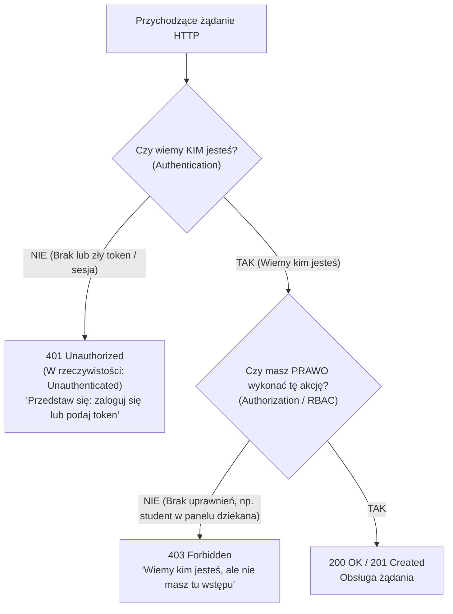

| Kod statusu | Znaczenie biznesowe | Przyczyna | Jak naprawić? |
| :---: | :--- | :--- | :--- |
| **401 Unauthorized** | **Brak uwierzytelnienia** (*Unauthenticated*) | Brak tokenu JWT, wygasła sesja, błędne hasło | Zalogować się, podać poprawny nagłówek `Authorization` |
| **403 Forbidden** | **Brak uprawnień** (*Unauthorized*) | Użytkownik jest zalogowany, ale rola nie pozwala na dostęp | Zmiana roli konta / kontakt z administratorem |

---

### 5.4. Przekierowania: 301 vs 302 vs 307 vs 308

W erze nowoczesnych aplikacji webowych kluczowe jest rozróżnienie między przekierowaniami klasycznymi a przekierowaniami rygorystycznymi, które **gwarantują zachowanie metody HTTP**:

| Kod statusu | Typ | Zmiana metody HTTP na GET? | Zastosowanie |
| :---: | :---: | :---: | :--- |
| **301 Moved Permanently** | Trwałe | **Często TAK** (historyczna anomalia przeglądarek: zmieniały POST na GET) | Przekierowanie starych adresów URL, zmiana struktury domeny |
| **302 Found** | Tymczasowe | **Często TAK** (zmienia POST na GET) | Tradycyjny wzorzec PRG (Post/Redirect/Get) po formularzu |
| **307 Temporary Redirect** | Tymczasowe | **NIGDY (Gwarantowane)** | Przekierowanie żądania POST z zachowaniem metody i payloadu |
| **308 Permanent Redirect** | Trwałe | **NIGDY (Gwarantowane)** | Nowoczesny odpowiednik 301 dla API REST (zachowuje POST/PUT/DELETE) |

---

## 6. Anatomia wiadomości HTTP i kluczowe nagłówki

W protokole HTTP wiadomości (zarówno żądania, jak i odpowiedzi) składają się z trzech logicznych części:
1. **Linii początkowej** (*Start Line*: Request Line lub Status Line).
2. **Nagłówków** (*Headers*) zakończonych **pustą linią** (`CRLF` – `\r\n`).
3. **Ciała wiadomości** (*Message Body / Payload*) – opcjonalne.

### 6.1. Struktura komunikatu (Request & Response)

```text
ŻĄDANIE (HTTP Request):
+-------------------------------------------------------------+
| GET /api/v1/profil HTTP/1.1              <- Request Line    |
| Host: api.twojadomena.pl                 <- Nagłówek Host   |
| User-Agent: Mozilla/5.0 ...              <- Nagłówki        |
| Accept: application/json                                    |
| Authorization: Bearer eyJhbGci...                           |
|                                          <- Pusta linia     |
| (opcjonalne ciało żądania w POST/PUT)    <- Request Body    |
+-------------------------------------------------------------+

ODPOWIEDŹ (HTTP Response):
+-------------------------------------------------------------+
| HTTP/1.1 200 OK                          <- Status Line     |
| Date: Mon, 12 Oct 2026 10:00:00 GMT      <- Nagłówki        |
| Content-Type: application/json; charset=utf-8               |
| Content-Length: 142                                         |
| Cache-Control: private, max-age=3600                        |
|                                          <- Pusta linia     |
| {"id": 12, "imie": "Jan", "rola": "admin"} <- Response Body  |
+-------------------------------------------------------------+
```

---

### 6.2. Negocjacja treści (Content Negotiation)

Mechanizm ten pozwala klientowi i serwerowi uzgodnić optymalny format, kodowanie i język przesyłanych danych:

* **Typ mediów (MIME Type)**:
  * Żądanie: `Accept: application/json, text/html;q=0.9` (*Parametr `q` oznacza wagę preferencji od 0.0 do 1.0*).
  * Odpowiedź: `Content-Type: application/json; charset=utf-8`.
* **Kompresja danych**:
  * Żądanie: `Accept-Encoding: gzip, deflate, br, zstd` (klient deklaruje obsługiwane algorytmy: Brotli, Gzip, Zstandard).
  * Odpowiedź: `Content-Encoding: br` (serwer informuje, że ciało odpowiedzi skompresowano algorytmem Brotli).
* **Język i lokalizacja**:
  * Żądanie: `Accept-Language: pl-PL, pl;q=0.9, en-US;q=0.8`.

---

### 6.3. Mechanizmy pamięci podręcznej (Caching & Conditional Requests)

Prawidłowa konfiguracja nagłówków pamięci podręcznej to najważniejszy czynnik wpływający na wydajność i koszty infrastruktury aplikacji webowej.

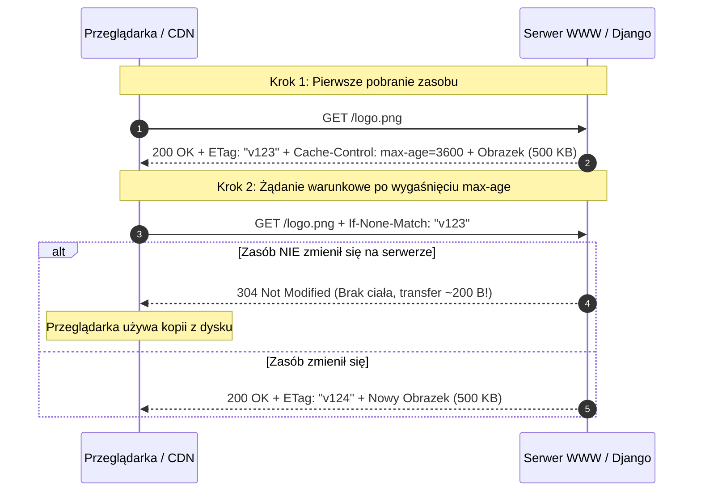

#### Kluczowe nagłówki:
1. **`Cache-Control`**:
   * `public`: Odpowiedź może być buforowana przez dowolnego pośrednika (serwery CDN, Proxy dostawców internetu).
   * `private`: Odpowiedź jest dedykowana wyłącznie jednemu użytkownikowi; może ją buforować przeglądarka, ale pośrednicy CDN nie mają do tego prawa (krytyczne dla stron po zalogowaniu!).
   * `no-cache`: Zasób **może** być zapisany w cache, ale przed każdym użyciem klient **musi zwalidować** jego świeżość z serwerem za pomocą zapytania warunkowego.
   * `no-store`: Bezwzględny zakaz zapisywania odpowiedzi w jakiejkolwiek pamięci trwałej (stosowane dla haseł, danych kart kredytowych).
   * `max-age=X`: Czas ważności zasobu w sekundach.
2. **Zapytania warunkowe (Walidatory świeżości)**:
   * **`ETag` (Entity Tag)**: Unikalny skrót (hash) reprezentujący wersję zasobu. Klient w kolejnym zapytaniu wysyła go w nagłówku `If-None-Match`. Jeśli hash na serwerze jest identyczny, serwer zwraca lekki status **304 Not Modified**.
   * **`Last-Modified`**: Data ostatniej modyfikacji, walidowana nagłówkiem `If-Modified-Since`.

---

### 6.4. Zarządzanie tożsamością i sesją: Ciasteczka i tokeny

Ponieważ protokół HTTP jest bezstanowy, do identyfikacji sesji użytkownika stosuje się mechanizm **ciasteczek (Cookies)** sterowany nagłówkiem serwera `Set-Cookie`.

#### Bezpieczeństwo ciasteczek – parametry obowiązkowe w produkcji:
```http
Set-Cookie: session_id=a8f9c32b; Path=/; Domain=twojadomena.pl; Secure; HttpOnly; SameSite=Lax; Max-Age=86400
```

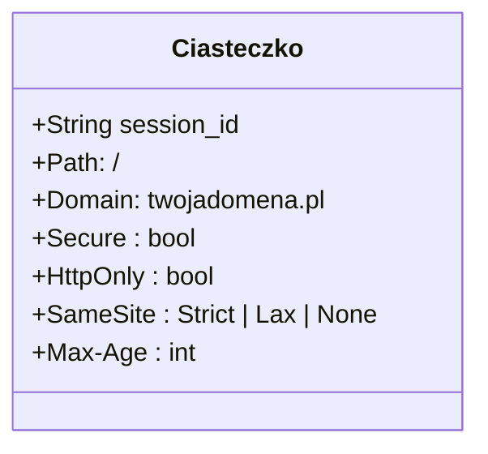

* **`Secure`**: Ciasteczko będzie przesyłane **wyłącznie przez połączenia szyfrowane HTTPS**. Chroni przed podsłuchem w sieci otwartej (np. publiczne Wi-Fi).
* **`HttpOnly`**: Bezwzględny zakaz dostępu do ciasteczka z poziomu języka JavaScript (`document.cookie`). Chroni sesję przed kradzieżą w razie ataku **Cross-Site Scripting (XSS)**.
* **`SameSite`**: Kluczowa ochrona przed atakami **Cross-Site Request Forgery (CSRF)**:
  * `Strict`: Ciasteczko nie jest wysyłane w żadnych zapytaniach pochodzących z obcych domen (nawet przy kliknięciu w zewnętrzny link).
  * `Lax` (domyślne we współczesnych przeglądarkach): Ciasteczko jest przesyłane przy nawigacji na najwyższym poziomie (kliknięcie w link), ale blokowane przy żądaniach POST/iframe z obcej domeny.
  * `None`: Ciasteczko wysyłane w żądaniach między domenami (wymaga obowiązkowo flagi `Secure`).

---

### 6.5. Bezpieczeństwo i polityki przeglądarkowe (HSTS, CSP, CORS)

Nowoczesny serwer WWW komunikuje się z silnikiem przeglądarki za pomocą dedykowanych nagłówków ochronnych:

1. **HSTS (`Strict-Transport-Security`)**:
   * Wymusza na przeglądarce łączenie się z serwisem **wyłącznie przez HTTPS** przez określony czas, uniemożliwiając ataki typu SSL Stripping:
   ```http
   Strict-Transport-Security: max-age=31536000; includeSubDomains; preload
   ```
2. **CSP (`Content-Security-Policy`)**:
   * Definiuje białą listę zaufanych źródeł, z których przeglądarka może ładować skrypty JS, style CSS, czcionki i obrazy. Podstawowy mechanizm mitygacji ataków XSS.
3. **CORS (Cross-Origin Resource Sharing)**:
   * Polityka **Same-Origin Policy (SOP)** w przeglądarce domyślnie blokuje skryptom JS z domeny `frontend.pl` odczytywanie danych z API pod adresem `api.backend.pl`.
   * Aby na to zezwolić, serwer API musi zwrócić odpowiednie nagłówki CORS:
   ```http
   Access-Control-Allow-Origin: https://frontend.pl
   Access-Control-Allow-Methods: GET, POST, PUT, DELETE
   Access-Control-Allow-Headers: Content-Type, Authorization
   ```
   * W przypadku metod innych niż proste (np. `PUT`, `DELETE` lub z nagłówkiem `Authorization`), przeglądarka najpierw wysyła zapytanie testowe **Preflight Request** metodą `OPTIONS`.

---

## 7. Protokół HTTPS i warstwa TLS

Protokół **HTTPS (HTTP Secure)** to nic innego jak standardowy protokół HTTP uruchomiony wewnątrz bezpiecznego, szyfrowanego tunelu kryptograficznego **TLS (Transport Layer Security)**.

### 7.1. Dlaczego sam HTTP jest niebezpieczny? Podsłuch, modyfikacja, podszywanie

Nieszyfrowany ruch HTTP przesyłany jest otwartym tekstem (*plaintext*). Każdy węzeł pośredniczący w sieci (router w kawiarni, dostawca internetu, serwery tranzytowe) jest podatny na trzy zagrożenia:
1. **Podsłuch (*Eavesdropping*)**: Przechwytywanie haseł, ciasteczek sesyjnych, danych osobowych.
2. **Modyfikacja (*Tampering / MitM*)**: Wstrzykiwanie obcych skryptów reklamowych, fałszowanie odpowiedzi bankowych przez atakującego.
3. **Podszywanie się (*Spoofing / Impersonation*)**: Serwer podszywający się pod domenę banku bez możliwości weryfikacji tożsamości przez użytkownika.

HTTPS gwarantuje trzy filary bezpieczeństwa: **Poufność** (szyfrowanie), **Integralność** (kody MAC zapobiegające zmianie bitów) oraz **Uwierzytelnienie** (certyfikaty tożsamości).

---

### 7.2. Model kryptografii hybrydowej

Bezpieczna komunikacja HTTPS wykorzystuje **kryptografię hybrydową**:
* **Kryptografia asymetryczna (klucz publiczny i prywatny - ECDHE / RSA)**: Bardzo bezpieczna, lecz wymagająca dużej mocy obliczeniowej. Służy **wyłącznie na samym początku** do uwierzytelnienia serwera i bezpiecznego uzgodnienia wspólnego klucza symetrycznego.
* **Kryptografia symetryczna (wspólny klucz sesji - AES-GCM / ChaCha20-Poly1305)**: Niezwykle szybka, wspomagana sprzętowo przez instrukcje procesora (AES-NI). Służy do szyfrowania właściwego transferu danych HTTP.

---

### 7.3. Przebieg uścisku dłoni (TLS 1.3 Handshake)

W standardzie **TLS 1.3 (RFC 8446)** czas nawiązywania połączenia zredukowano z 2 RTT (w TLS 1.2) do zaledwie **1 RTT** (jeden uścisk dłoni przed rozpoczęciem transferu danych):

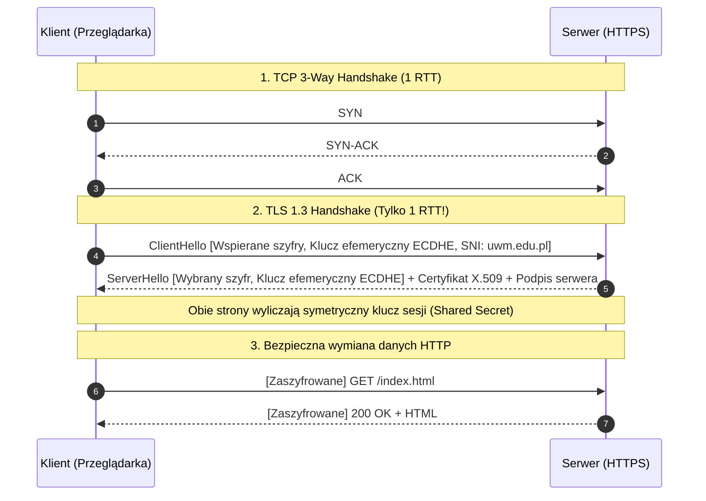

---

### 7.4. Certyfikaty cyfrowe X.509, PKI, Let's Encrypt i rola SNI / ALPN

Skąd przeglądarka wie, że serwer o adresie IP `140.82.121.4` to rzeczywiście `github.com`, a nie złośliwy serwer proxy?
* Odpowiada za to **Infrastruktura Klucza Publicznego (PKI)** i **certyfikaty X.509**.
* Zaufane urzędy certyfikacji (**Certificate Authorities – CA**, np. Let's Encrypt, DigiCert) podpisują certyfikat serwera swoim kluczem prywatnym.
* Przeglądarka internetowa oraz system operacyjny posiadają wbudowany magazyn certyfikatów głównych (**Root CA store**), weryfikując kryptograficzny **łańcuch zaufania (*Chain of Trust*)**.

#### Rola mechanizmów SNI oraz ALPN:
* **SNI (Server Name Indication)**:
  * W uścisku dłoni TLS klient wysyła nazwę hosta (`Host: twojadomena.pl`) zanim połączenie zostanie zaszyfrowane. Pozwala to jednemu serwerowi WWW posiadającemu jeden adres IP serwować setki różnych certyfikatów SSL dla różnych domen.
* **ALPN (Application-Layer Protocol Negotiation)**:
  * Rozszerzenie TLS umożliwiające negocjację protokołu aplikacyjnego (`http/1.1`, `h2`, `h3`) bezpośrednio podczas uścisku dłoni TLS, oszczędzając dodatkowe zapytania sieciowe.

---

## 8. Od gniazda TCP do frameworka webowego: Cykl życia żądania w Django

Zrozumienie protokołu HTTP ma kluczowe znaczenie dla programisty backendu. Jak surowy pakiet HTTP trafia do widoku Django i staje się obiektem w kodzie Pythona?

### 8.1. Architektura serwera: Reverse Proxy (Nginx) -> WSGI/ASGI (Gunicorn/Uvicorn)

W środowiskach produkcyjnych aplikacje Django nigdy nie są wystawiane bezpośrednio na świat. Stosuje się architekturę warstwową:

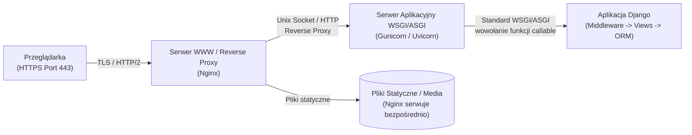

1. **Nginx (Reverse Proxy)**:
   * Obsługuje terminację TLS/HTTPS i kompresję gzip/brotli.
   * Samodzielnie serwuje pliki statyczne (CSS, obrazy), odciążając procesy Pythona.
   * Zabezpiecza przed atakami typu Slowloris i ogranicza liczbę zapytań (*rate limit*).
2. **Gunicorn / Uvicorn (Serwer WSGI/ASGI)**:
   * Zarządza pulą procesów i wątków Pythona.
   * Odbiera surowe zapytanie od Nginxa i tłumaczy je na specyfikację **WSGI (Web Server Gateway Interface)** lub asynchroniczną **ASGI (Asynchronous Server Gateway Interface)**.

---

### 8.2. Transformacja: od surowego strumienia bajtów do obiektu `HttpRequest`

Serwer WSGI parsuje linie i nagłówki HTTP ze strumienia sieciowego, a następnie tworzy słownik środowiskowy Pythona (`environ`), z którego Django konstruuje instancję klasy `HttpRequest`:

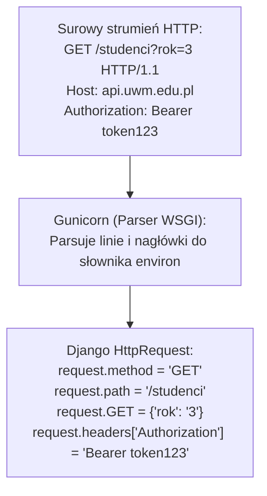

```python
# Poglądowy przykład mapowania HTTP na kod w widoku Django
from django.http import JsonResponse, HttpResponseForbidden

def lista_studentow(request):
    # 1. Odczyt metody HTTP
    if request.method != 'GET':
        return HttpResponseNotAllowed(['GET']) # Zwróci kod 405 Method Not Allowed
        
    # 2. Odczyt parametrów z URL (Query String)
    rok = request.GET.get('rok', '1') # Parsuje "?rok=3"
    
    # 3. Odczyt nagłówków HTTP (zamiana 'Authorization' na request.headers)
    auth_header = request.headers.get('Authorization')
    if not auth_header:
        return HttpResponse(status=401) # Zwróci kod 401 Unauthorized
        
    # 4. Konstrukcja i zwrot odpowiedzi HTTP
    dane = [{"id": 1, "nazwisko": "Kowalski", "rok": rok}]
    return JsonResponse(dane, status=200) # Formuje nagłówek Content-Type: application/json oraz kod 200
```

---

### 8.3. Łańcuch przetwarzania (Middleware Pipeline) i zwrot `HttpResponse`

Przed dotarciem do widoku, obiekt `request` przepływa przez łańcuch komponentów pośredniczących (**Middleware**):

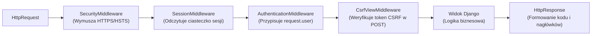

Gdy widok zwraca obiekt `HttpResponse` (lub `JsonResponse`), Django transformuje go z powrotem w format specyfikacji HTTP (status line, nagłówki, treść bajtowa) i odsyła do serwera WSGI, Nginxa i ostatecznie do przeglądarki użytkownika.

---

## 9. Warsztat inżynierski: Diagnostyka i inspekcja HTTP

Praktyczna umiejętność debugowania komunikacji HTTP na poziomie konsoli i przeglądarki to kluczowa kompetencja inżyniera oprogramowania webowego.

### 9.1. Zaawansowane wykorzystanie cURL

Narzędzie `curl` pozwala na precyzyjną emulację dowolnego klienta HTTP:

```bash
# 1. Wyświetlenie wyłącznie nagłówków odpowiedzi (metoda HEAD):
curl -I https://uwm.edu.pl

# 2. Pełny podgląd negocjacji TLS, nagłówków żądania i odpowiedzi (tryb gadatliwy):
curl -v https://api.github.com/users/kropiak

# 3. Wysłanie zapytania POST z payloadem JSON oraz nagłówkiem Authorization:
curl -X POST https://api.twojadomena.pl/v1/logowanie \
     -H "Content-Type: application/json" \
     -H "Authorization: Bearer twoj_token_jwt" \
     -d '{"login": "student", "haslo": "tajne123"}'

# 4. Sprawdzenie obsługi HTTP/2 lub HTTP/3:
curl --http2 -I https://www.google.com
curl --http3 -I https://cloudflare.com

# 5. Badanie czasu poszczególnych faz połączenia (DNS, TCP, TLS, TTFB):
curl -o /dev/null -s -w "\
DNS Lookup:    %{time_namelookup}s\n\
TCP Connect:   %{time_connect}s\n\
TLS Handshake: %{time_appconnect}s\n\
TTFB:          %{time_starttransfer}s\n\
Total Time:    %{time_total}s\n" https://uwm.edu.pl
```

> [!TIP] Porada
> **TTFB (Time to First Byte)**: Czas mierzony od wysłania żądania do odebrania pierwszego bajtu odpowiedzi z serwera. To kluczowy wskaźnik wydajności backendu – wysoki TTFB wskazuje na powolne zapytania w bazie danych lub wąskie gardła w kodzie aplikacji.

---

### 9.2. Wykorzystanie Chrome DevTools (zakładka Network)

Narzędzia deweloperskie w przeglądarce umożliwiają wizualną analizę kaskady zasobów:
1. **Status**: Kolorowe oznaczenie kodów statusu (zielony: 2xx/3xx, czerwony: 4xx/5xx).
2. **Type**: Typ MIME zasobu wynegocjowany nagłówkiem `Content-Type`.
3. **Waterfall (Wodospad)**:
   * *Queueing / Stalled*: Czas oczekiwania w kolejce połączeń przeglądarki.
   * *DNS Lookup / Initial Connection / SSL*: Czas nawiązywania połączenia sieciowego.
   * *Waiting for server response (TTFB)*: Czas przetwarzania żądania przez serwer backendowy.
   * *Content Download*: Czas fizycznego pobierania pliku przez łącze.

---

## 10. Materiały, literatura i ciekawostki

### Literatura i specyfikacje standardów:
1. **RFC 9110 (HTTP Semantics)**: Oficjalna nadrzędna specyfikacja semantyki protokołu HTTP z czerwca 2022 roku: [datatracker.ietf.org/doc/html/rfc9110](https://datatracker.ietf.org/doc/html/rfc9110)
2. **RFC 9112 (HTTP/1.1)** oraz **RFC 9113 (HTTP/2)**: Nowoczesne standardy formatów i ramkowania: [RFC 9112](https://datatracker.ietf.org/doc/html/rfc9112), [RFC 9113](https://datatracker.ietf.org/doc/html/rfc9113)
3. **RFC 9114 (HTTP/3)** & **RFC 9000 (QUIC)**: Rewolucja transportowa nad protokołem UDP: [RFC 9114](https://datatracker.ietf.org/doc/html/rfc9114)
4. **MDN Web Docs (Mozilla)**: Najpełniejszy podręcznik referencyjny nagłówków i kodów HTTP: [developer.mozilla.org/en-US/docs/Web/HTTP](https://developer.mozilla.org/en-US/docs/Web/HTTP)
5. **Daniel Stenberg**: *Everything curl* – kompleksowy podręcznik transferu danych w sieci: [everything.curl.dev](https://everything.curl.dev/)
6. **Ilya Grigorik**: *High Performance Browser Networking* (O'Reilly) – wybitna pozycja o optymalizacji TCP, TLS, HTTP/2 i HTTP/3 dostępna bezpłatnie online: [hpbn.co](https://hpbn.co/)

---

### Ciekawostki inżynierskie:

* **Ciekawostka 1: Kod 418 I'm a teapot**  
  W primaaprilisowym dokumencie **RFC 2324** (1998 r.) zdefiniowano protokół HTCPCP (*Hyper Text Coffee Pot Control Protocol*). Wśród kodów błędów wprowadzono status `418 I'm a teapot` zwracany, gdy ekspres do kawy zostanie poproszony o zaparzenie herbaty. Kod ten stał się tak kultowy, że mimo żartobliwego pochodzenia został zaimplementowany w setkach bibliotek webowych i ostatecznie zastrzeżony w RFC 9110, by nikt nie wykorzystał go do innych celów.
* **Ciekawostka 2: Klucze DNSSEC do Internetu**  
  Bezpieczeństwo systemu DNS (rozwiązującego nazwy domen na adresy IP przed wysłaniem żądania HTTP) opiera się na ceremonii kluczy DNSSEC zarządzanej przez organizację ICANN. 14 wyznaczonych strażników z całego świata (7 posiadaczy kluczy fizycznych i 7 zastępców) spotyka się na ściśle strzeżonych ceremoniach, by wygenerować kryptograficzne podpisy dla strefy root globalnego internetu.
* **Ciekawostka 3: Pierwsza strona internetowa wciąż działa**  
  Pierwsza strona stworzona przez Tima Bernersa-Lee w grudniu 1990 roku w ośrodku CERN jest nadal aktywna pod historycznym adresem: [info.cern.ch/hypertext/WWW/TheProject.html](https://info.cern.ch/hypertext/WWW/TheProject.html).
* **Ciekawostka 4: Pochodzenie słowa Bug**  
  Choć pojęcie błędu było używane wcześniej przez Thomasa Edisona, to pierwszy udokumentowany przypadek fizycznego "buga komputerowego" miał miejsce w 1947 roku, gdy Grace Hopper i jej zespół znaleźli prawdziwą ćmę uwięzioną w przekaźniku komputera Harvard Mark II, wklejając ją do dziennika pokładowego z notatką: *"First actual case of bug being found"*.
* **Ciekawostka 5: Unikalność zapytań w Google**  
  Według oficjalnych danych inżynierów Google, każdego dnia około **15% zapytań** wpisywanych w wyszukiwarkę to frazy, które nigdy wcześniej w historii nie zostały zadane w dokładnie takiej postaci.

---

_&copy; Krzysztof Ropiak, 2026. Materiał dydaktyczny do użytku wewnętrznego – Uniwersytet Warmińsko-Mazurski w Olsztynie._
